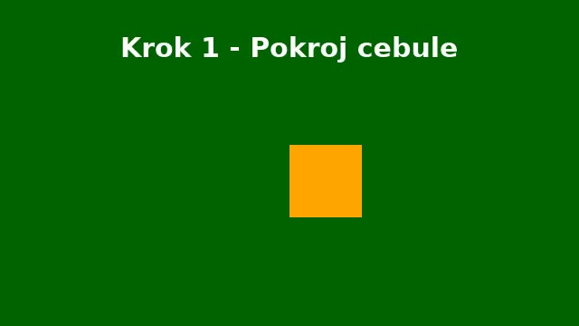
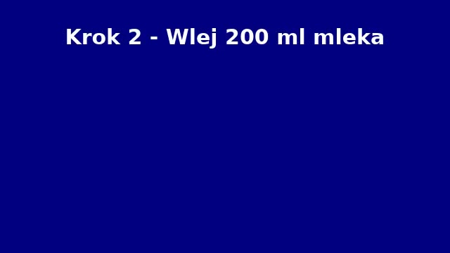
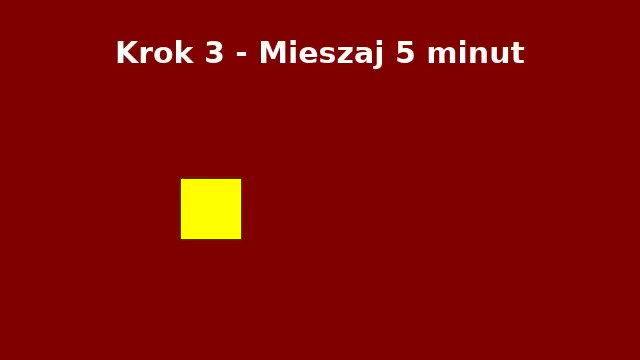

# przepis z mową.mp4

- Źródło: tests/data/Filmy testowe ąęś/przepis z mową.mp4
- Długość: 00:32 · obraz 640×360 · audio: tak
- Silniki: mowa `faster-whisper:small:cpu`, obraz `ollama:qwen3-vl:4b-instruct`, streszczenie `ollama:qwen3-vl:4b-instruct`

## Streszczenie

_Brak — wklej `prompt_dla_claude.md` do Claude albo uruchom z `--streszczenie`._

## Ograniczenia analizy

- Kadry co najwyżej co 8 s — krótkie czynności między kadrami mogły zostać pominięte.
- Streszczenie nie powstało: Ollama nie odpowiedziała w 600 s (TimeoutError).

## Oś czasu (mowa + obraz)

### 00:00–00:08
  
**Obraz** _(z obrazu, pewność: wysoka)_: Zielony ekran z białym napisem i pomarańczowym kwadratem w centrum. — tekst na ekranie: Krok 1 - Pokroj cebule
**Mowa** _(z mowy)_: Najpierw krujmy jedną cebulę w drobną kostkę.

### 00:08–00:16
  
**Obraz** _(z obrazu, pewność: wysoka)_: Jednolity niebieski ekran z białym tekstem instrukcyjnym. — tekst na ekranie: Krok 2 - Wlej 200 ml mleka
**Mowa** _(z mowy)_: Teraz wywamy 200 ml mleka.

### 00:16–00:25
  
**Obraz** _(z obrazu, pewność: wysoka)_: Czerwony ekran z białym napisem i żółtym kwadratem. — tekst na ekranie: Krok 3 - Mieszaj 5 minut
**Mowa** _(z mowy)_: Mieszamy przez 5 minut na małym obniu.

### 00:25–00:26
  
**Obraz** _(z obrazu, pewność: wysoka)_: Czerwony ekran z białym napisem i żółtym kwadratem. — tekst na ekranie: Krok 3 - Mieszaj 5 minut
**Mowa** _(z mowy)_: brak danych

### 00:26–00:32
  
**Obraz** _(z obrazu, pewność: wysoka)_: Czarny ekran z białym tekstem w centrum. — tekst na ekranie: Gotowe! Smacznego
**Mowa** _(z mowy)_: Gotowe, smacznego!

## Pełna transkrypcja

`00:00` Najpierw krujmy jedną cebulę w drobną kostkę.  
`00:08` Teraz wywamy 200 ml mleka.  
`00:17` Mieszamy przez 5 minut na małym obniu.  
`00:26` Gotowe, smacznego!  
